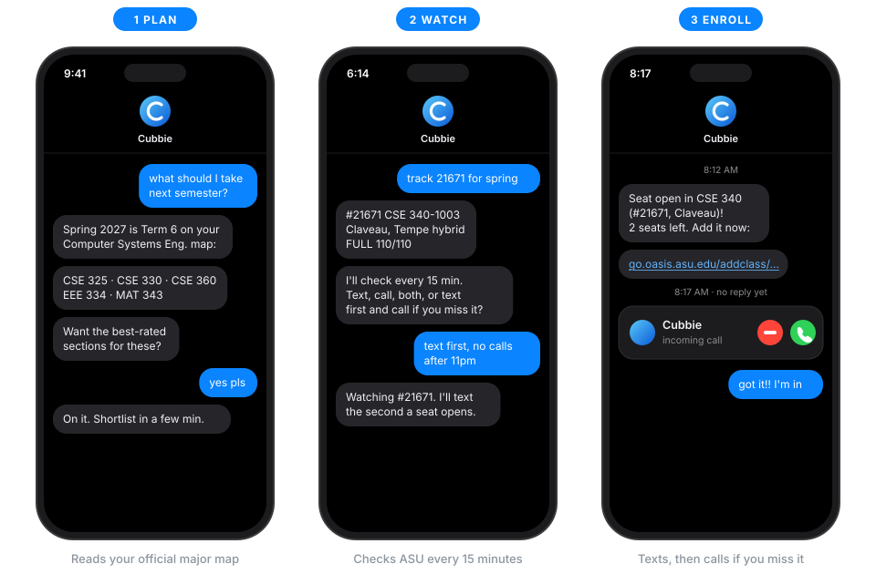
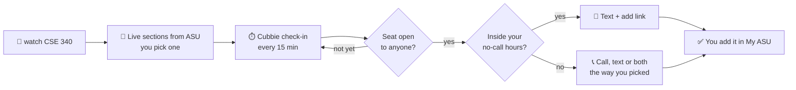

<div align="center">

# 🎯 Seat Snipe

### Stop refreshing Class Search. Text Cubbie instead.

**Plan your ASU semester, pick the best-rated sections, and get a text or a call the second a seat opens.**

<br/>


<br/>



<sub>Illustration of the flow. The output below is real.</sub>

</div>

---

## 😩 The problem

Registration opens and the section you need says **0 open seats**. So you refresh Class Search in lecture, in line
for coffee, at 1 AM. When a seat finally frees up, it goes to whoever happened to refresh at that moment.

Seat Snipe makes sure that's you.

## 🧾 Real output, not a mockup

Texted to Cubbie on Oct 24, 2026: *"check CSE 412 for spring 2027"*

```text
CSE 412 Database Management, Spring 2027 (term 2271): 4 sections, 0 full
#31637 CSE 412-1002 | MW 10:30 AM-11:45 AM, Tempe CDN60 | Hasan Davulcu | 9 open of 160, plus 126 reserved
#18443 CSE 412-1001 | TTh 12:00 PM-1:15 PM, Tempe CDN60 | Ms Jia Zou | 9 open of 160, plus 117 reserved
#32714 CSE 412-1003 | MW 12:00 PM-1:15 PM, Tempe CDN60 | Hasan Davulcu | 15 open of 160, plus 105 reserved
#25546 CSE 412-2001 | online, no set meeting time | Hasan Davulcu | 37 open of 125, plus 6 reserved
```

See **"9 open, plus 126 reserved"**? Capacity minus enrolled would say 135 open seats. But 126 of them are held for
specific groups of students, so only 9 are actually up for grabs. Seat Snipe tells you which number is real.

## ✨ What it does

<table>
<tr>
<td width="33%" valign="top">

### 🗺️ Plan

*"What should I take next semester?"*

Cubbie reads your **official ASU major map** and texts back the critical courses, the rest of the term, and
your elective slots.

</td>
<td width="33%" valign="top">

### ⭐ Pick

*"Who's the best professor for CSE 330?"*

The **easiest electives** and **best-rated sections**, from Rate My Professors reviews plus live seats. Got
favorites already? Your picks win.

</td>
<td width="33%" valign="top">

### 🎯 Snipe

*"Watch CSE 340 for spring."*

Checks ASU **every 15 minutes** and alerts you the second a seat opens, with the add link ready to tap.

</td>
</tr>
</table>

## 🧰 Features

| | |
| --- | --- |
| 💬 **Plain English** | "check CSE 412 for spring" just works. No class numbers needed: pick a section by its time or professor. |
| 🔒 **Honest seat counts** | Separates seats anyone can take from seats reserved for specific majors or cohorts. |
| 🧪 **Lecture + lab sets** | Need both? Watch them together, and the alert only comes when both have a seat. |
| 📞 **Alerts your way** | A text with the add link, a call, both, or a text first with a call if you don't reply in 5 minutes. |
| 🌙 **No-call hours** | Pick a window like 11pm to 8am. Openings during it arrive as a text, not a 3 AM ring. |
| 🔁 **One alert per opening** | Quiet while a seat stays open, and re-armed automatically if it fills and opens again. |
| ⌛ **Stops on its own** | After the last day to add, when a section is cancelled, or when you say you got in. |
| 🚨 **Never silently blind** | If ASU stops answering for an hour, you hear about it once. |
| 🧯 **Built-in fallback** | If ASU turns Cubbie's servers away, it reads the public class search page in its own browser instead. |
| 🎬 **Test alert** | Text "send me a test alert" to see and hear exactly what an opening looks like. |
| 🧠 **Remembers you** | Your major, alert style and no-call hours are asked once, then saved. |

## 🔄 How it works



## 📲 Install (10 seconds)

Text this link to **Cubbie** and reply "yes" when it asks:

```text
https://github.com/Aadharsh21/seat-snipe
```

Then try any of these:

- *"what should I take next semester?"*
- *"check CSE 412 for spring 2027"*
- *"watch the hybrid CSE 340 section and call me when a seat opens"*
- *"no calls after 11pm"*
- *"send me a test alert"*

## 🛡️ What it will never do

> ❌ Enroll, drop, swap or pay for you &nbsp;·&nbsp; ❌ Ask for your ASU password &nbsp;·&nbsp; ❌ Text anyone but you
> &nbsp;·&nbsp; ❌ Guess a seat count or make up a rating
>
> **You always make the final tap in My ASU.** Ratings are labeled as student reviews, and your watch list and
> preferences stay on your own Cubbie drive.

## 🔧 Under the hood

```text
seat-snipe/
├── SKILL.md             what Cubbie reads: when to use it, every step, reply style, failure handling
├── scripts/seats.py     search · compare · watch · check · alerts · drill · ack · followup
├── assets/              a saved real ASU response for --sample runs, and this README's graphic
└── README.md
```

- **Split of work.** The script does everything that has to be exact: ASU lookups, seat math, alert-once state
  under `~/.config/seat-snipe/`, and no-call hours in your own time zone. Cubbie does the talking: texts, calls,
  check-ins and its browser.
- **Polite.** One request per watched course every 15 minutes, with a plain User-Agent that names the Skill.
- **Zero setup.** Python standard library only. No packages, no keys, no sign-in.

Try it without a network connection, using a saved real response:

```bash
python3 scripts/seats.py search --term "spring 2027" --course "CSE 340" --sample
python3 scripts/seats.py watch add --term 2271 --course "CSE 340" --class 21671 --sample
python3 scripts/seats.py check --sample
python3 scripts/seats.py drill
```

## ⚠️ Honest limits

- ASU only, though it covers every campus and ASU Online.
- Checks every 15 minutes, so a seat that opens and fills in between can be missed.
- It can't see your holds, prerequisites, or whether you qualify for reserved seats.
- "Easiest" and "best-rated" come from Rate My Professors reviews, which can be out of date.
- Your degree audit in My ASU is the final word on requirements; the major map is the recommended order.

## 👥 Team

Built at **DevHacks Fall 2026** for the [Cubbie Hackathon](https://hackathon.cubbie.ai) by
[@Aadharsh21](https://github.com/Aadharsh21) and [@swayamvindo8](https://github.com/swayamvindo8).

**Credits:** seat data comes from ASU's public class search. Thanks to
[rajkumaar23/asu-course-notifier](https://github.com/rajkumaar23/asu-course-notifier) for documenting how it
answers. Seat Snipe is a student project, not affiliated with Arizona State University or Rate My Professors.

---

<div align="center">

**Like it? [Vote for Seat Snipe on hackathon.cubbie.ai →](https://hackathon.cubbie.ai/#gallery)**

</div>
